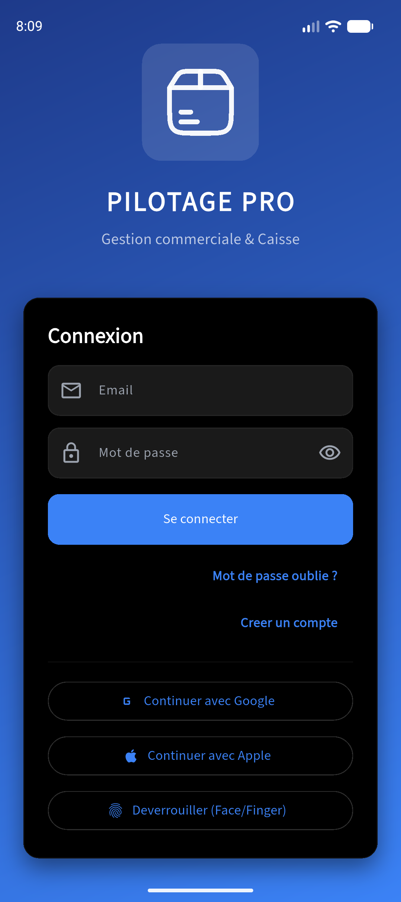
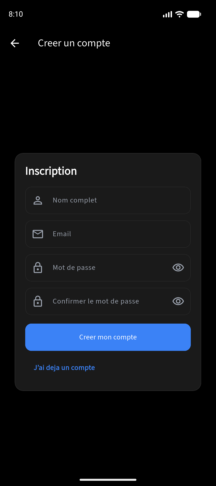

# Pilotage Pro

<p>
  
  
</p>

Application de caisse et de pilotage pour un commerce : ventes, stock, factures, crédits et plusieurs points de vente, en francs CFA.

These screens are the real login and sign-up flows, captured on an Android emulator from the debug build. The dashboard, register, stock, and reports open after a Firebase sign-in, so they are not shown here.


**Pilotage Pro** is a Flutter mobile application for **business management and point of sale (POS)**. It targets shops and small businesses that need to manage products, stock, sales, cash registers, users, and financial reporting from one app. The UI is primarily in **French**, and amounts are oriented toward **XAF (Franc CFA)**.

---

## Purpose

The app helps you:

- Sell at the register (POS / “Caisse”)
- Track inventory and stock movements
- Manage product catalogs and categories
- Follow invoices and payments (including credit sales)
- Monitor sales, margins, credits, and expenses
- Operate across **multiple store locations** (points de vente)
- Control **users and roles** with cloud-backed authentication

---

## Technology Stack

| Layer | Technology |
|--------|------------|
| **UI** | Flutter (Material 3), custom theme & design tokens |
| **State** | Riverpod (`Notifier` / `AsyncNotifier`) |
| **Navigation** | GoRouter (shell + bottom navigation) |
| **Backend (active)** | **Firebase** — Auth + Cloud Firestore |
| **Backend (planned)** | Appwrite / Supabase via abstraction (`Noop*` gateways today) |
| **Charts** | `fl_chart` |
| **Images** | `image_picker`, `flutter_image_compress`, `cached_network_image` |
| **Auth extras** | Google Sign-In, Sign in with Apple, `local_auth` (biometrics) |
| **Local prefs** | `shared_preferences` (theme, last email, biometric flag) |

---

## Architecture

The codebase follows a **layered** structure:

```
lib/
├── domain/entities/     # Business models (Product, Invoice, User, …)
├── data/
│   ├── baas/            # AuthGateway, DocumentStore (Firebase / Noop)
│   ├── repositories/    # Firestore CRUD per collection
│   └── bootstrap/       # Optional Firestore seed service
├── app/
│   ├── providers/       # Riverpod notifiers + repositories wiring
│   └── router/          # Routes & bottom nav shell
└── features/            # Screens by domain (auth, pos, stock, …)
```

**BaaS abstraction:** `AuthGateway` and `DocumentStore` let you switch backends (`BaaSBackendType.firebase | appwrite | supabase`). Only **Firebase is fully implemented**; other backends return no-ops until wired.

**Data flow:** Screens → Riverpod notifiers → Firestore repositories → `FirebaseDocumentStore`. Changes are written to Firestore asynchronously.

**Firestore collections:** `products`, `categories`, `invoices`, `users`, `locations`, `stock_movements`, `cash_registers`, `credits`, `expenses`.

---

## Main Navigation

After login, a **bottom navigation bar** exposes five hubs:

| Tab | Route | Role |
|-----|--------|------|
| **Accueil** | `/dashboard` | Overview & quick actions |
| **Caisse** | `/pos` | Point of sale |
| **Stock** | `/stock` | Inventory hub |
| **Ventes** | `/invoices` | Invoice list |
| **Rapports** | `/reports` | Financial reports |

Additional screens (settings, users, cash, product detail, etc.) are reached via routes or dashboard shortcuts; detail routes hide the bottom bar.

### All routes

| Route | Screen |
|-------|--------|
| `/` | Login |
| `/signup` | Sign up |
| `/forgot-password` | Forgot password |
| `/dashboard` | Dashboard |
| `/pos` | Point of sale |
| `/products` | Product catalog |
| `/products/:id` | Product detail |
| `/stock` | Stock hub |
| `/stock/entry` | Stock entry |
| `/stock/movement` | Stock movements |
| `/stock/valuation` | Stock valuation |
| `/invoices` | Invoice list |
| `/invoices/:id` | Invoice detail |
| `/reports` | Financial reports |
| `/users` | User management |
| `/cash` | Cash register management |
| `/settings` | Settings |

---

## Feature Modules

### Authentication

- Email/password login via Firebase Auth
- Google and Apple sign-in
- Session restore on launch → redirect to dashboard if already signed in
- Biometric unlock (when enabled on device)
- Sign up with profile creation in Firestore
- Forgot password flow
- Domain `User` linked to Firebase user (auto-created in Firestore if missing)

**Roles:** `admin`, `vendeur`, `caissier`.

### Dashboard

- Welcome card (user name, role)
- KPI cards: today’s sales, month sales, product count, customer credits
- Revenue chart (monthly — partly from mock data for the chart series)
- Low-stock alerts and recent invoices
- Quick actions: new sale, stock entry, users, cash management
- Link to Settings

### Point of Sale (Caisse)

- Search products by name/barcode
- Filter by category
- Cart in end drawer (quantities, clear)
- Simulated barcode scan
- Payment: cash, card, mobile, credit
- Credit sales with partial payment → invoice `enAttente`
- On payment: creates invoice, decrements stock, logs stock movement (sale)

### Product Catalog

**Product list:**

- Search, category filters, low-stock-only filter
- Create/edit products in a bottom sheet form

**Product fields:**

- Image (gallery picker, compression ≥50%, dashed upload area)
- Name, description, barcode
- Purchase price (PA) and selling price (PV), min/max PV
- Quantity, safety stock, unit (pièce, kg, etc.)
- Category — searchable dropdown (max 6 visible), create category inline
- Type: Produit or Service
- Location association

**Images:** HTTPS URLs use `AppNetworkImage` (cached); local paths use `Image.file` (device-local until cloud storage is added).

### Categories

- Managed from catalog and inline during product creation
- Stored in Firestore `categories`
- Search + create in the same field as selection

### Stock Management

| Feature | Route | Status |
|---------|--------|--------|
| Stock entry | `/stock/entry` | Available |
| Movements | `/stock/movement` | Available (entrée, sortie, transfert, ajustement) |
| Valuation | `/stock/valuation` | Available (PA/PV, margins) |
| Safety stock | → `/products` | Via low-stock flags |
| Unit conversions | — | Planned |
| Full history | — | Planned |

Movements record previous/new quantity, user, reason, and reference (e.g. invoice number).

### Invoices / Sales

- List with search and status filter (payée, en attente, annulée)
- Invoice detail view
- Tied to cashier, location, payment method, credit flag
- Auto-generated invoice numbers (`FAC-…`)

### Financial Reports

Three tabs:

1. **Chiffre d’affaires** — total sales, pending, expenses, net profit, charts
2. **Crédits & Dettes** — customer credits vs supplier debts
3. **Marges** — margin analysis from products/invoices

Uses live invoice/credit/expense data from Firestore (dashboard monthly chart may still use mock series).

### Cash Register Management

Per selected location:

- Open/close cash register session
- Opening float, closing balance, variance
- Links to today’s sales
- History in Firestore `cash_registers`

### User Management

- List users with role and assigned location
- Add/edit users (name, email, role, location)
- Activate/deactivate users
- Synced with Firestore `users`

### Settings

- User profile summary
- Switch active location (point de vente)
- Language (French, UI placeholder)
- Currency display (XAF)
- Theme: system / light / dark
- Notifications toggle (UI placeholder)
- Backup / restore placeholders
- Data reset dialog
- About & support
- Logout

---

## Domain Model

| Entity | Purpose |
|--------|---------|
| **Product** | Item or service; prices, stock, category, image, barcode |
| **Category** | Product grouping |
| **Invoice** + **InvoiceItem** | Sales documents and line items |
| **StockMovement** | Audit trail for inventory changes |
| **User** | Staff accounts and roles |
| **Location** | Store / warehouse sites |
| **CashRegister** | Cash drawer sessions |
| **Credit** | Customer credit or supplier debt |
| **Expense** | Operating expenses for reports |
| **MonthlyRevenue** | Chart data (partially mock) |

**Enums:** `ProductType`, `InvoiceStatus`, `MovementType`, `PaymentMethod`, `UserRole`.

---

## Multi-Location

- `selectedLocationProvider` drives filtering (products by location, cash register per site)
- User can switch location in Settings
- Products and sales can be scoped to a location

---

## Security & Cloud

- Firebase Auth required for Firestore access (security rules deployed)
- Unauthenticated reads may return empty/null to avoid crashes before login
- No anonymous demo login — real Firebase sign-in only

---

## UI Conventions

- **Hugeicons** via custom `HIcon` wrapper
- **CurrencyText** for formatted money
- **InvoiceStyleCard** for consistent cards
- French labels throughout
- Remote images: use `AppNetworkImage` (see `AGENTS.md`)

---

## Current Limitations / Work in Progress

1. **Product images** on device are local file paths — not yet uploaded to Firebase Storage for cross-device sync.
2. **Monthly revenue chart** on dashboard may still use mock data while other metrics use Firestore.
3. **Appwrite / Supabase** backends are stubbed (`NoopAuthGateway`, `NoopDocumentStore`).
4. Some settings items (backup, restore, notifications) are UI placeholders.
5. Stock menu items **Conversions** and **Historique** are marked coming soon.
6. **Firestore seed** on startup was removed (permission issues before login); seed service exists but is not auto-run.
7. **Global route guards** are minimal (session restore mainly on login screen).

---

## Getting Started

```bash
flutter pub get
flutter run
```

Firebase must be configured (`lib/firebase_options.dart`, `google-services` / iOS plist). See Firebase console project `omniflow-a1811` if using the existing deployment.

---

## Version

- **App version:** `1.0.0+1`
- **Description:** Pilotage Pro — Business Management & POS Application
